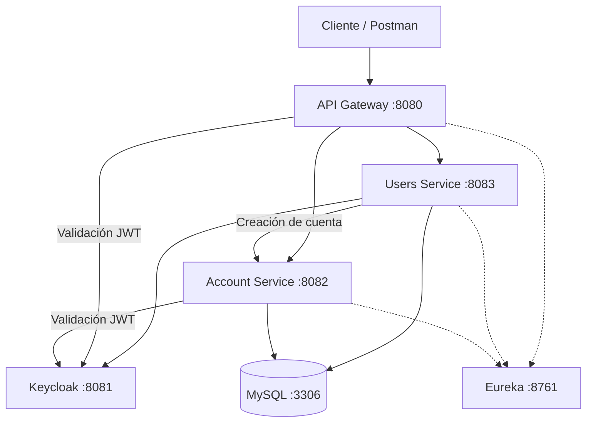

# Digital Money House

Backend de una billetera digital desarrollado con arquitectura de microservicios. Permite registrar usuarios, gestionar su perfil y cuenta, consultar saldos y movimientos, asociar tarjetas, ingresar dinero y realizar transferencias internas mediante CVU o alias.

## Tecnologías utilizadas

- Java 21 y Spring Boot 3.5.
- Spring Cloud: Eureka, API Gateway, OpenFeign y LoadBalancer.
- Spring Security, Keycloak y JWT.
- MySQL 8.4, Spring Data JPA/Hibernate y Flyway para las migraciones de usuarios.
- Docker y Docker Compose.
- Swagger/OpenAPI con springdoc.
- JUnit, Mockito, MockMvc y Spring Boot Test; H2 para las pruebas de integración de usuarios.
- Postman para pruebas de API; Git y GitHub para control de versiones.

## Arquitectura del sistema



| Servicio            | Responsabilidad                                                                    |
| ------------------- | ---------------------------------------------------------------------------------- |
| `users-service`     | Registro, autenticación, cierre de sesión y perfil; crea la cuenta mediante Feign. |
| `account-service`   | Cuentas, saldos, alias, tarjetas, depósitos, transferencias y actividad.           |
| `api-gateway`       | Entrada a la API, enrutamiento y validación de JWT.                                |
| `service-discovery` | Registro y descubrimiento de servicios con Eureka.                                 |

Keycloak administra las identidades y emite los tokens. Las transferencias forman parte de `account-service`; no hay un microservicio de transacciones separado.

## Inicio rápido

### Requisitos

- Docker
- Docker Compose
- Git
- Puertos libres: `3306`, `8080`, `8081`, `8083` y `8761`

1. Clonar el repositorio.

   ```bash
   git clone https://github.com/lautarorisso/digital-money-house
   cd digital-money-house
   ```

2. **Configurar el entorno.** Copiar `.env.example` a `.env` y reemplazar los valores antes de levantar el stack:

   ```bash
   cp .env.example .env
   ```

   | Variable                                 | Qué es                                                                   | De dónde la sacás                                                          |
   | ---------------------------------------- | ------------------------------------------------------------------------ | -------------------------------------------------------------------------- |
   | `KEYCLOAK_ADMIN_PASSWORD`                | Contraseña para entrar a la consola de admin de Keycloak                 | La elegís vos                                                              |
   | `KEYCLOAK_BACKEND_CLIENT_SECRET`         | Secreto compartido entre Keycloak y el backend (debe ser igual en ambos) | Se genera con `openssl rand -hex 32` en la terminal y se pega el resultado |
   | `MYSQL_ROOT_PASSWORD` / `MYSQL_PASSWORD` | Contraseñas de la base de datos MySQL                                    | Las elegís vos                                                             |

3. Levantar todo el stack:

   ```bash
   docker compose up -d --build
   ```

4. **Verificar que arrancó:**

   ```bash
   docker compose ps
   ```

Compose levanta MySQL, Keycloak y los cuatro servicios. Keycloak importa el realm desde `docker/keycloak/realm-export.json`; no hace falta crearlo manualmente. Esperar a que los servicios aparezcan en Eureka (`http://localhost:8761`) antes de enviar solicitudes.

## Puertos y servicios

| Servicio                   | Puerto en Docker | Puerto publicado en el host |
| -------------------------- | ---------------- | --------------------------- |
| MySQL                      | `3306`           | `3306`                      |
| api-gateway                | `8080`           | `8080`                      |
| Keycloak                   | `8081`           | `8081`                      |
| users-service              | `8083`           | `8083`                      |
| service-discovery (Eureka) | `8761`           | `8761`                      |
| account-service            | `8082`           | No publicado                |

Para consumir la API, usar el gateway (`http://localhost:8080`). Los endpoints de `account-service` se acceden mediante `/accounts-service/**`; su puerto `8082` solo se utiliza dentro de la red de Docker, por lo que **no necesita estar libre en el host** al ejecutar con Compose.

## Logs y Swagger

La documentación se abre sin token desde el gateway:

- [Swagger de usuarios](http://localhost:8080/users-service/swagger-ui/index.html)
- [Swagger de cuentas y tarjetas](http://localhost:8080/accounts-service/swagger-ui/index.html)

Iniciar sesión con `POST /users-service/auth/login`. Para probar endpoints protegidos, pegar el `accessToken` en **Authorize → bearerAuth**; para logout, usar el `refreshToken` en **Authorize → refreshToken**. Ambos se ingresan sin el prefijo `Bearer`.

Los logs de consola registran login, logout, depósitos y transferencias exitosos, sin contraseñas, tokens ni datos de tarjetas:

```bash
docker compose logs -f users-service account-service
```

## Endpoints principales

Base de la API: `http://localhost:8080`. Los ejemplos son ilustrativos: usar los IDs y tokens devueltos por las propias solicitudes.

En los endpoints protegidos, enviar `Authorization: Bearer <accessToken>`. Registro y login no requieren token; logout usa el **refresh token**.

### Tabla resumida de rutas

| Método | Ruta a través del gateway                                      | Operación                              | Éxito |
| ------ | -------------------------------------------------------------- | -------------------------------------- | ----- |
| POST   | `/users-service/users/register`                                | Registrar usuario y crear su cuenta.   | `201` |
| POST   | `/users-service/auth/login`                                    | Iniciar sesión.                        | `200` |
| POST   | `/users-service/user/logout`                                   | Cerrar sesión con refresh token.       | `200` |
| GET    | `/users-service/users/{userId}`                                | Consultar perfil propio.               | `200` |
| PATCH  | `/users-service/users/{userId}`                                | Actualizar perfil.                     | `201` |
| GET    | `/accounts-service/accounts/{accountId}`                       | Consultar cuenta y saldo.              | `200` |
| PATCH  | `/accounts-service/accounts/{accountId}`                       | Cambiar alias.                         | `201` |
| POST   | `/accounts-service/accounts/{accountId}/cards`                 | Asociar tarjeta.                       | `201` |
| GET    | `/accounts-service/cards/accounts/{accountId}/cards`           | Listar tarjetas.                       | `200` |
| GET    | `/accounts-service/cards/accounts/{accountId}/cards/{cardId}`  | Consultar tarjeta.                     | `200` |
| DELETE | `/accounts-service/cards/accounts/{accountId}/cards/{cardId}`  | Eliminar tarjeta.                      | `200` |
| POST   | `/accounts-service/accounts/{accountId}/deposits`              | Ingresar dinero desde una tarjeta.     | `201` |
| POST   | `/accounts-service/accounts/{accountId}/transferences`         | Transferir a otra cuenta del sistema.  | `200` |
| GET    | `/accounts-service/accounts/{accountId}/transferences`         | Consultar últimos cinco destinatarios. | `200` |
| GET    | `/accounts-service/accounts/{accountId}/transactions`          | Consultar últimos cinco movimientos.   | `200` |
| GET    | `/accounts-service/accounts/{accountId}/activity`              | Consultar actividad con filtros.       | `200` |
| GET    | `/accounts-service/accounts/{accountId}/activity/{transferId}` | Consultar detalle de un movimiento.    | `200` |

### Usuarios y autenticación

#### Registrar usuario — `POST /users-service/users/register`

Crea el usuario y su cuenta automáticamente.

**Request**

```json
{
  "nombre": "Lautaro",
  "apellido": "Risso",
  "dni": 12345678,
  "email": "lautaro.risso@example.com",
  "telefono": "+541112345678",
  "password": "Ejemplo123!"
}
```

**Response: `201 Created`**

```json
{
  "id": 1,
  "nombre": "Lautaro",
  "apellido": "Risso",
  "dni": 12345678,
  "email": "lautaro.risso@example.com",
  "telefono": "+541112345678",
  "cvu": "00000000000000000002",
  "alias": "lautaro.risso.dmh",
  "accountId": 2
}
```

`id` identifica al usuario; `accountId`, a su cuenta. El servidor genera CVU y alias. Datos inválidos o email duplicado: `400`; servicio de cuentas no disponible: `503`.

#### Iniciar sesión — `POST /users-service/auth/login`

**Request**

```json
{ "email": "lautaro.risso@example.com", "password": "Ejemplo123!" }
```

**Response: `200 OK`**

```json
{
  "accessToken": "<accessToken>",
  "refreshToken": "<refreshToken>",
  "tokenType": "Bearer",
  "expiresIn": 300
}
```

Credenciales inválidas: `400`; usuario inexistente: `404`.

#### Perfil y cierre de sesión

| Método y ruta                         | Uso                                                      | Respuesta                                         |
| ------------------------------------- | -------------------------------------------------------- | ------------------------------------------------- |
| `GET /users-service/users/{userId}`   | Consultar el perfil propio.                              | `200`, datos del usuario.                         |
| `PATCH /users-service/users/{userId}` | Actualizar campos del perfil.                            | `201`, perfil actualizado.                        |
| `POST /users-service/user/logout`     | Enviar `Authorization: Bearer <refreshToken>`, sin body. | `200`, sin cuerpo. Refresh token inválido: `400`. |

### Cuentas, tarjetas y movimientos

#### Consultar cuenta y saldo — `GET /accounts-service/accounts/{accountId}`

Sin body. **Response: `200 OK`**

```json
{
  "id": 2,
  "cvu": "00000000000000000002",
  "alias": "lautaro.risso.dmh",
  "balance": 0.0
}
```

#### Asociar tarjeta — `POST /accounts-service/accounts/{accountId}/cards`

**Request**

```json
{ "cardNumber": "4111111111111111", "type": "DEBIT" }
```

**Response: `201 Created`**

```json
{ "id": 1, "type": "DEBIT" }
```

`type` puede ser `DEBIT` o `CREDIT`. Tarjeta duplicada o ya asociada: `409`.

#### Ingresar dinero — `POST /accounts-service/accounts/{accountId}/deposits`

Requiere una tarjeta asociada a la cuenta.

**Request**

```json
{ "cardId": 1, "amount": 10.0 }
```

**Response: `201 Created`**

```json
{
  "id": 1,
  "amount": 10.0,
  "type": "CREDIT",
  "description": "Card deposit",
  "transactionDate": "<fecha ISO-8601>",
  "balanceAfter": 10.0
}
```

El importe debe ser positivo y tener como máximo dos decimales. Importe inválido: `400`.

#### Transferir dinero — `POST /accounts-service/accounts/{accountId}/transferences`

El destino debe ser el CVU o alias de otra cuenta del sistema.

**Request**

```json
{ "destination": "bruno.cuenta.dmh", "amount": 1.0 }
```

**Response: `200 OK`**

```json
{ "message": "ok" }
```

Importe o destino inválido: `400`; saldo insuficiente: `410`.

#### Eliminar tarjeta — `DELETE /accounts-service/cards/accounts/{accountId}/cards/{cardId}`

Sin body. **Response: `200 OK`, sin cuerpo.** Tarjeta inexistente: `404`.

#### Otras operaciones

| Método y ruta, después de `/accounts-service`     | Uso                                                                          | Respuesta                      |
| ------------------------------------------------- | ---------------------------------------------------------------------------- | ------------------------------ |
| `PATCH /accounts/{accountId}`                     | Cambiar alias con `{"alias":"nuevo.alias.dmh"}`.                             | `201`, cuenta actualizada.     |
| `GET /cards/accounts/{accountId}/cards`           | Listar tarjetas.                                                             | `200`, array de `{id,type}`.   |
| `GET /accounts/{accountId}/transactions`          | Consultar los últimos cinco movimientos.                                     | `200`, array de movimientos.   |
| `GET /accounts/{accountId}/activity`              | Consultar actividad; filtros `from`, `to`, `type`, `minAmount`, `maxAmount`. | `200`, array de movimientos.   |
| `GET /accounts/{accountId}/activity/{transferId}` | Consultar un movimiento.                                                     | `200`, detalle del movimiento. |
| `GET /accounts/{accountId}/transferences`         | Consultar los últimos cinco destinatarios distintos.                         | `200`, array de `{cvu,alias}`. |

Los filtros de fecha usan `YYYY-MM-DD` y `type` admite `CREDIT` o `DEBIT`. Los errores de validación devuelven `400`; acceder a recursos de otro usuario, `403`; un JWT ausente, inválido o vencido en endpoints protegidos, `401`. Los esquemas completos están en Swagger.

## Probar los endpoints con Postman

### Importar la colección

1. Postman → File → Import…
2. Seleccionar los dos archivos de `docs/postman/`:
   - `Digital-Money-House.postman_collection.json`
   - `Digital-Money-House.postman_environment.json`
3. Elegir el environment "Digital Money House — Local" (ya trae `baseUrl = http://localhost:8080`).

La colección incluye las carpetas **Registro**, **Login** y **Logout** (Sprint 1), **Sprint 2**, **Sprint 3** y **Sprint 4**. Para Sprint 1, ejecutar Registro → Login → Logout. Para Sprint 2, 3 o 4, seleccionar directamente la carpeta correspondiente y pulsar **Run**; cada una prepara sus propios datos automáticamente.

Antes de ejecutar, esperar a que el stack esté listo y los servicios estén registrados en Eureka (`http://localhost:8761`).

### Prueba manual mínima

1. Registrar dos usuarios y guardar sus respectivos `id`, `accountId`, CVU y alias.
2. Iniciar sesión con ambos y conservar sus tokens por separado.
3. Con el access token del primer usuario, consultar su cuenta, asociar una tarjeta e ingresar dinero.
4. Transferir parte del saldo al CVU o alias del segundo usuario.
5. Con cada token, verificar el saldo y la actividad de su propia cuenta. Probar también un importe superior al saldo disponible: debe responder `410` sin alterar los saldos.
6. Eliminar la tarjeta de prueba y cerrar ambas sesiones usando sus refresh tokens.

La colección y las planillas enlazadas debajo incluyen los casos completos y las validaciones de error.

## Informes de testing

- [QA SignOff — Sprints 1 a 4](docs/testing/qa-signoff.md)

### Sprint 1

- [Informe de testing exploratorio](docs/testing/sprint-1-testing-exploratorio.md)
- [Planilla de casos de prueba](docs/testing/sprint-1-testing-manual.md)

### Sprint 2

- [Planilla de casos de prueba](docs/testing/sprint-2-testing-manual.md)

### Sprint 3

- [Informe de testing exploratorio](docs/testing/sprint-3-testing-exploratorio.md)
- [Planilla de casos de prueba](docs/testing/sprint-3-testing-manual.md)

### Sprint 4

- [Informe de testing exploratorio](docs/testing/sprint-4-testing-exploratorio.md)
- [Planilla de casos de prueba](docs/testing/sprint-4-testing-manual.md)

## Testing automatizado

Sprint 1 (Postman):

```bash
postman collection run docs/postman/Digital-Money-House.postman_collection.json -e docs/postman/Digital-Money-House.postman_environment.json -i "Registro" -i "Login" -i "Logout" --no-report-events
```

Sprint 2:

```bash
./mvnw -pl services/api-gateway -Dtest=Sprint2SmokeIT -Ddmh.baseUrl=http://localhost:8080 test
```

Sprint 3:

```bash
./mvnw -pl services/api-gateway -Dtest=Sprint3ActivityIT -Ddmh.baseUrl=http://localhost:8080 test
```

Sprint 4 (Postman):

```bash
postman collection run docs/postman/Digital-Money-House.postman_collection.json -e docs/postman/Digital-Money-House.postman_environment.json -i "Sprint 4" --no-report-events
```

Para los tests de los módulos, con Java 21 instalado:

```bash
./mvnw test
```

Las pruebas de API de Sprint 2 y 3 y la colección de Postman requieren el stack levantado. Para los comandos `postman`, instalar Postman CLI. El alcance incluye registro y autenticación, cuentas, tarjetas, depósitos, actividad y transferencias, con escenarios exitosos y de error; los resultados están en los informes de testing.

## Decisiones técnicas

- **Keycloak y JWT:** se delegan las credenciales y la emisión de tokens para evitar implementar y mantener un sistema de autenticación propio. Los JWT permiten validar el acceso en el gateway y los servicios; la autorización sobre cada recurso se verifica con su propietario.
- **Transferencias dentro de `account-service`:** cuentas, saldos y movimientos pertenecen al mismo dominio. Mantenerlos juntos permite actualizar ambos saldos y registrar débito y crédito en una única transacción: si falla, se revierte toda la operación. Un `transaction-service` con datos propios exigiría coordinación entre servicios y mecanismos adicionales de consistencia. Para el alcance actual del proyecto, esta separación no nos da beneficios suficientes que justifiquen esa complejidad, ya que no se requiere desplegar ni escalar las transferencias de forma independiente.
- **Feign y compensación del registro:** la comunicación síncrona permite devolver los datos de la cuenta en el registro. Compartir MySQL no hace que ambos servicios compartan una transacción. Si falla el guardado local, se intenta eliminar la identidad creada en Keycloak; ante un rechazo definitivo de la creación de cuenta, se intenta eliminar también el usuario local. Los mensajes informan que la limpieza fue intentada, sin prometer una reversión completa.
- **Creación idempotente de cuenta:** repetir la solicitud con el mismo `userId` y `ownerSub` devuelve la cuenta existente sin regenerar CVU ni alias; otra identidad se rechaza. La restricción única por usuario evita duplicados concurrentes y, ante una colisión, se consulta la cuenta después de revertir la transacción fallida. Esto permite repetir una vez la llamada Feign cuando no se conoce el resultado. Si tampoco se confirma en el segundo intento, se conservan usuario e identidad para no dejar una cuenta sin su propietario; la recuperación posterior es manual, sin procesos automáticos.
- **Transacciones y bloqueos:** los saldos se calculan en el servidor para no confiar en valores enviados por el cliente. Las transacciones evitan cambios parciales y los bloqueos protegen las cuentas ante transferencias concurrentes. Bloquearlas en orden de ID reduce el riesgo de interbloqueos, a costa de que las operaciones sobre una misma cuenta deban esperar.
- **Variables de entorno y volúmenes:** separar las credenciales del código permite configurar cada entorno sin modificar la aplicación. Los volúmenes evitan perder datos al recrear contenedores; no reemplazan una copia de seguridad.
- **Logs básicos:** se utiliza la salida de consola existente para facilitar el diagnóstico sin incorporar una plataforma de monitoreo para este alcance. Se registran operaciones exitosas después de completarse y se excluyen contraseñas, tokens y datos de tarjetas.

## Problemas encontrados y soluciones aplicadas

| Problema encontrado                                                                                        | Cómo se resolvió                                                                                                                                                                           |
| ---------------------------------------------------------------------------------------------------------- | ------------------------------------------------------------------------------------------------------------------------------------------------------------------------------------------ |
| El registro aceptaba contraseñas de un solo carácter.                                                      | Se incorporó la validación de longitud de 8 a 64 caracteres; las solicitudes fuera de ese rango responden `400`.                                                                           |
| Un JSON malformado devolvía `500`.                                                                         | Se agregó un manejo específico de errores de lectura del body para devolver `400` con un mensaje claro.                                                                                    |
| Los caracteres de nombre o apellido rechazados por Keycloak provocaban `500`.                              | Se tradujo el rechazo del proveedor a una respuesta `400` que identifica el campo inválido.                                                                                                |
| El logout respondía `200` sin token o con un refresh token inválido.                                       | Se exigió el refresh token y se propagó el rechazo de Keycloak como `400`, en lugar de informar un cierre exitoso.                                                                         |
| Un fallo al guardar el usuario después de crear su identidad no intentaba compensar Keycloak.              | Se agregó el intento de eliminar la identidad y se informa que la compensación fue intentada, sin garantizar una reversión completa.                                                       |
| Una respuesta perdida al crear la cuenta podía disparar el borrado del usuario aunque la cuenta existiera. | Se hizo idempotente la creación y se repite la misma solicitud una vez. Si el resultado sigue incierto, se conservan usuario e identidad para reconciliación manual; no se borra a ciegas. |

## Autor

[lautarorisso](https://github.com/lautarorisso)

## Notas

- Los datos persisten en volúmenes Docker: se conservan con `docker compose down` y se borran solo con `docker compose down -v`.
- Detener el stack: `docker compose down`.
